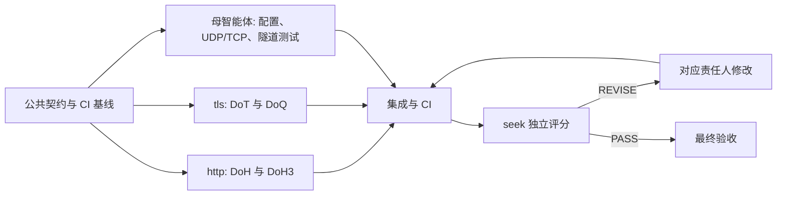

# xdns 加密 Resolver 实施计划

> **For agentic workers:** REQUIRED SUB-SKILL: Use superpowers:subagent-driven-development. Steps use checkbox (`- [ ]`) syntax for tracking.

**Goal:** 按评估文档为现有 xdns 客户端接入 DoT、DoH、DoQ 和 DoH3，逐协议拆分模块，并通过独立评分审查。

**Architecture:** 保留 DNS wire-format、域名编码、分片和轮询。公共层负责报文副本、有界调度、请求期限、响应关联和关闭；协议层只负责交换原始报文。母智能体负责公共接线，http 和 tls 子智能体并行实现，seek 独立审查。

**Tech Stack:** 仓库现有 Go、crypto/tls、net/http、golang.org/x/net/http2、github.com/apernet/quic-go/http3 和 Protobuf。测试使用 GitHub Actions。

**Spec:** [xdns-resolver-adaptation-assessment.md](../../xdns-resolver-adaptation-assessment.md)。人类指定该文档作为实现依据，并明确要求并行编写、评分和修改。

## Global Constraints

- 只在 `cptdnsv2` 分支提交。保留已有工作，不改写远端历史。
- 每协议一个文件：`doh.go`、`doh3.go`、`dot.go`、`doq.go`。
- 不新增或升级产品依赖，不改造 app/dns 公共接口，不添加服务端加密监听器。
- 使用 finalmask 的底层可取消拨号。保持 origin、认证身份与 bootstrap IP 的职责。
- 严格验证证书，禁止明文降级、0-RTT 和自动重放已提交查询。
- 首版 DNS wire 上限为 4096 字节，超限明确拒绝；上层 PacketConn 的容量保持现有约定。
- 请求期限为 5 秒，16 个交换 worker、64 个等待请求和 64 个结果槽；不暴露未要求的调优配置。
- JSON 保留 addrs；新增 serverName、bootstrap 和复用现有 TLS 证书格式的 certificates，只接受 verify 根证书。
- tls/quic 默认 853；https/https+h3 默认 443；HTTPS 空路径为 /dns-query，保留 path/query，拒绝 userinfo、fragment、无效 host/port。
- ResolverProto 字段 1、2 保留；新增 server_name=3、bootstrap=4、certificates=5，由 CI 重新生成 config.pb.go。
- Send 返回错误；成功只表示接纳并持有副本。Read 不截断，不因单个请求失败永久停收；Close 幂等且解阻等待。

## Review Focus

- Close 与 Send、重连、排队同时发生：先取消，再关闭资源和等待，禁止持状态锁执行无限网络 I/O。
- 调用方分片复用输入缓冲：异步请求必须持有独立副本，测试延迟交换。
- 相同 DNS ID、错误 Question 和迟到响应：完整关联并恢复原 ID，避免串包。
- 错误 TLS 身份、bootstrap、HTTP 重定向和隐式重放：认证与 origin 保持正确，失败不降级。
- QUIC 连接已从 HTTP 池删除或握手失败：依然关闭拥有的 Transport 与 PacketConn。

## DAG 与文件归属



### Task 1: 公共层、配置与基线（母智能体）

**Files:** resolver.go、resolver_udp.go、resolver_tcp.go、client.go、config.go、config.proto、config.pb.go、finalmask.go、infra/conf/transport_finalmask.go；对应 resolver/配置/finalmask 测试；.github/workflows/xdns.yml。

**Interfaces:**
- `Resolver.Send([]byte) error`，其他方法签名保持原样。
- `newRequestResolver(addr *net.UDPAddr, exchange func(context.Context, []byte) ([]byte, error), closeTransport func()) *requestResolver`。
- `resolverTarget(hostPort, bootstrap string, network net.Network) (net.Destination, *net.UDPAddr, error)`。
- `resolverTLSConfig(config *ResolverProto, serverName string, nextProtos ...string) (*tls.Config, error)`。
- `validateDNSQuery([]byte) error`、`validateDNSResponse(query, response []byte) error`。
- `maxDNSMessageSize=4096`、`resolverRequestTimeout=5*time.Second`。
- Dialer 新增 `DialTCPContext`、`DialUDPContext`，保留旧回调。
- 测试共用 `resolverTestCertificate(t) (tls.Certificate, []byte)` 和隧道网关工具，私有 CA 通过 Certificates 注入。

- [ ] 写配置兼容、TCP 帧、输入所有权、短缓冲、队列满和关闭回归测试；先在 CI 观察失败。
- [ ] 实现公共调度、错误传播、完整报文校验、严格 TLS/目标校验和 Proto 字段。
- [ ] 修 TCP 帧与短写；UDP/TCP 使用可取消拨号并检查类型断言；关闭先取消。
- [ ] 调整 client.send/WriteTo/poll；Close 在等待读写锁前发出取消。
- [ ] xdns 声明 HandleDial，验证 mask 顺序与原始 socket 所有权。
- [ ] CI 生成 Proto、格式化并提交生成结果，运行相关包和 race。

### Task 2: HTTP 协议（http）

**Files:** doh.go、doh3.go、doh_test.go、doh3_test.go。HTTP 共用处理放在 doh.go。

**Interfaces:** 消费 Task 1 接口；产出 `NewDoHResolver(*ResolverProto, *finalmask.Dialer) (Resolver, error)` 和 `NewDoH3Resolver(*ResolverProto, *finalmask.Dialer) (Resolver, error)`。

- [ ] 先写本地 H2/H3 测试，证明实际协议、原始 POST、URL 保真、身份与 bootstrap、证书拒绝和 ID 恢复。
- [ ] 实现严格媒体类型/状态/大小/结构校验、请求取消和资源回收；GetBody=nil，拒绝重定向。
- [ ] 覆盖乱序并发、错误/慢正文、连接恢复和活动中关闭；使用真实 xdns 双向数据测试。
- [ ] 交付变更文件、测试证据和剩余限制；收到 seek 问题后修改并再次验收。

### Task 3: TLS/QUIC 协议（tls）

**Files:** dot.go、doq.go、dot_test.go、doq_test.go。

**Interfaces:** 消费 Task 1 接口；产出 `NewDoTResolver(*ResolverProto, *finalmask.Dialer) (Resolver, error)` 和 `NewDoQResolver(*ResolverProto, *finalmask.Dialer) (Resolver, error)`。

- [ ] 先写本地 TLS/QUIC 测试，证明 DoT 帧/唯一 ID/乱序关联与 DoQ 独立流/零 ID/长度/FIN。
- [ ] 实现连接复用、严格认证/ALPN、请求取消、协议错误和资源关闭；不复用已用 DoT wire ID。
- [ ] 覆盖重复原 ID、坏帧、迟到响应、超时、重连、关闭和 socket 回收；DoQ 拒绝 UDP/53。
- [ ] 用真实 xdns 双向数据测试验证分片和轮询；收到 seek 问题后修改并再次验收。

### Task 4: 独立评分与最终验证（seek / 母智能体）

**Files:** docs/superpowers/plans/2026-10-12-xdns-progress.md；独立审查报告。

- [ ] seek 以独立上下文核查代码、CI 输出和评估要求，不接受实现者自评作为证据。
- [ ] 按 seek 自行建立的六项 rubric 输出分数和 PASS/REVISE，逐项记录问题与触发条件。
- [ ] 将问题交回对应责任人；任何修改均须再次 CI 验证并由 seek 重评。
- [ ] 通过条件由 seek 决定；完成时报告四协议隧道、配置回归、race 和未验证部署范围。

## 验证命令

```sh
go test -timeout 10m ./transport/internet/finalmask/xdns ./transport/internet/finalmask ./infra/conf
go test -race -timeout 10m ./transport/internet/finalmask/xdns ./transport/internet/finalmask
go test -timeout 10m ./app/dns ./transport/internet/tls ./transport/internet/splithttp
```

公网递归器、权威委派、上层实际承载与性能测试需要部署数据。交付必须明确这些范围的验证状态，不以本地测试代替。
