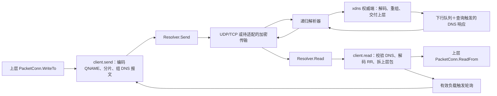

# xdns resolver 加密 DNS 协议适配评估

## 1. 结论摘要

四种协议在传输层均可适配。建议保留 xdns 的 DNS 报文编码、分片和轮询，在 Resolver 内增加传输实现。现有接口需要补充错误、缓冲所有权和生命周期约定；TCP 实现也有必须先修正的问题。不能只增加协议名称和拨号分支，就认定适配完成。

推荐顺序为：建立 UDP/TCP 隧道基线并修正基础问题 → DoT → HTTP/2 DoH → DoQ → DoH3。DoT 与现有 TCP 的帧格式最接近；DoH 可以使用现有 HTTP 库；DoQ 和 DoH3 都能使用已引入的 QUIC 库，但二者封装和请求关联机制不同。

主要结论如下：

- **源码事实：** Resolver 发送和接收完整 DNS wire-format 报文。它不负责把域名解析为 IP。隧道负载先编码进 QNAME，响应中的资源记录再还原为上层数据包。见 [transport/internet/finalmask/xdns/resolver.go:10](C:/Users/hppc/Repos/Xray-core_cptdnsv2/transport/internet/finalmask/xdns/resolver.go:10)、[transport/internet/finalmask/xdns/client.go:126](C:/Users/hppc/Repos/Xray-core_cptdnsv2/transport/internet/finalmask/xdns/client.go:126)、[transport/internet/finalmask/xdns/client.go:220](C:/Users/hppc/Repos/Xray-core_cptdnsv2/transport/internet/finalmask/xdns/client.go:220)。
- **源码事实＋标准库契约：** TCP 发送使用 `binary.Write(..., len(p))`，传入的是 `int`，且忽略错误。它不能正确写出要求的两字节长度头。这是复用 TCP 实现前的阻碍，本文未运行复现。见 [transport/internet/finalmask/xdns/resolver_tcp.go:121](C:/Users/hppc/Repos/Xray-core_cptdnsv2/transport/internet/finalmask/xdns/resolver_tcp.go:121) 和 [Go encoding/binary.Write](https://pkg.go.dev/encoding/binary#Write)。
- **分析推断：** 应复用仓库的 TLS、HTTP、QUIC 库和接线方式，不直接复用 `app/dns` 的 nameserver 对象。后者面向 A/AAAA 查询与 IP 缓存，会丢失 xdns 所需的完整 DNS 内容。见 [app/dns/nameserver.go:20](C:/Users/hppc/Repos/Xray-core_cptdnsv2/app/dns/nameserver.go:20)、[app/dns/dnscommon.go:130](C:/Users/hppc/Repos/Xray-core_cptdnsv2/app/dns/dnscommon.go:130)、[app/dns/dnscommon.go:187](C:/Users/hppc/Repos/Xray-core_cptdnsv2/app/dns/dnscommon.go:187)。
- **分析推断：** 加密客户端到递归解析器这一段，不会自动增加 xdns 权威端的响应容量，也不会消除查询类型过滤、缓存、限流和轮询等待。
- **待验证：** 四种协议均未完成本仓库的 xdns 互操作或性能实测。本文中的复杂度和性能判断来自代码结构与协议机制，不代表工期承诺或性能测量。

### 1.1 评估基线与标记

源码基线为提交 `701af60772cda123492f86e383e1fdba066614a9`，核查日期为 2026-10-11。分析开始时工作区无已报告的修改。本次只新增评估文档，不修改运行代码、配置或依赖。

文中“源码事实”指当前源码可直接确认的行为；“协议要求”指 RFC 或官方文档中的约束；“方案建议”和“分析推断”指尚未实现的设计判断；“待验证”指需要测试或部署环境确认的事项。各方案章节默认属于方案建议。

源码链接指向当前工作区的绝对路径和一基行号。后续代码变化可能导致行号移动。

## 2. 现有架构

### 2.1 调用关系与职责

`xdns.Config` 实现 finalmask 的 UDP 包装接口。客户端包装忽略传入的 `conn`、`dest`，直接创建 `NewClient`；服务端将传入的 `PacketConn` 交给 `NewServer`。见 [transport/internet/finalmask/xdns/config.go:8](C:/Users/hppc/Repos/Xray-core_cptdnsv2/transport/internet/finalmask/xdns/config.go:8)。

`NewClient` 为每条 resolver 配置创建对象，任一构造失败便关闭已创建对象并返回错误。运行后，每个 resolver 有一个接收 goroutine，客户端另有一个轮询 goroutine。见 [transport/internet/finalmask/xdns/client.go:56](C:/Users/hppc/Repos/Xray-core_cptdnsv2/transport/internet/finalmask/xdns/client.go:56)、[transport/internet/finalmask/xdns/client.go:81](C:/Users/hppc/Repos/Xray-core_cptdnsv2/transport/internet/finalmask/xdns/client.go:81)、[transport/internet/finalmask/xdns/client.go:288](C:/Users/hppc/Repos/Xray-core_cptdnsv2/transport/internet/finalmask/xdns/client.go:288)。



图中的递归解析器也可以由受控转发网关替代。当前 xdns 服务端接收的是 DNS 数据报，没有 DoT、DoH、DoQ 或 HTTP/3 监听器。新增客户端 resolver 并不等于服务端直接支持这些协议。若要直接连接加密的自建 xdns 入口，需要额外网关或服务端监听适配；这不属于仅修改 resolver 的最小方案。见 [transport/internet/finalmask/xdns/server.go:45](C:/Users/hppc/Repos/Xray-core_cptdnsv2/transport/internet/finalmask/xdns/server.go:45)、[transport/internet/finalmask/xdns/server.go:249](C:/Users/hppc/Repos/Xray-core_cptdnsv2/transport/internet/finalmask/xdns/server.go:249)。

### 2.2 Resolver 接口及 UDP/TCP 实现

当前接口如下，构造分发只接受 `udp` 和 `tcp`。见 [transport/internet/finalmask/xdns/resolver.go:10](C:/Users/hppc/Repos/Xray-core_cptdnsv2/transport/internet/finalmask/xdns/resolver.go:10)。

```go
type Resolver interface {
    Addr() *net.UDPAddr
    Read(p []byte) (int, error)
    Send(p []byte)
    Close()
}
```

| 项目 | UDP | TCP |
| --- | --- | --- |
| 建连 | 构造时调用 finalmask.Dialer.DialUDP，取出 PacketConnWrapper 中的 PacketConn | 构造时调用 DialTCP |
| 发包 | 同步 WriteTo；拨号和写错误被忽略 | 试图写长度头再写 DNS 报文；存在 int 长度头问题，错误被忽略 |
| 收包 | 一次 ReadFrom 获取一个报文，缓冲 4096 字节，忽略来源地址 | io.ReadFull 读取两字节大端长度和报文；跳过长度为 0 或超过 4096 的帧 |
| 交付 | 复制到池化缓冲，经无缓冲 readCh 交给 Read | 同左 |
| 恢复 | 读取失败后关闭连接并置空；下次 Send 才重新拨号 | 同左 |
| 超时 | 本层没有请求级 deadline、超时表或自动重传 | 同左 |
| 关闭 | 关闭连接，等待接收 goroutine，再关闭 readCh | 同左 |

依据：[transport/internet/finalmask/xdns/resolver_udp.go:25](C:/Users/hppc/Repos/Xray-core_cptdnsv2/transport/internet/finalmask/xdns/resolver_udp.go:25)、[transport/internet/finalmask/xdns/resolver_udp.go:52](C:/Users/hppc/Repos/Xray-core_cptdnsv2/transport/internet/finalmask/xdns/resolver_udp.go:52)、[transport/internet/finalmask/xdns/resolver_udp.go:99](C:/Users/hppc/Repos/Xray-core_cptdnsv2/transport/internet/finalmask/xdns/resolver_udp.go:99)、[transport/internet/finalmask/xdns/resolver_tcp.go:27](C:/Users/hppc/Repos/Xray-core_cptdnsv2/transport/internet/finalmask/xdns/resolver_tcp.go:27)、[transport/internet/finalmask/xdns/resolver_tcp.go:73](C:/Users/hppc/Repos/Xray-core_cptdnsv2/transport/internet/finalmask/xdns/resolver_tcp.go:73)、[transport/internet/finalmask/xdns/resolver_tcp.go:111](C:/Users/hppc/Repos/Xray-core_cptdnsv2/transport/internet/finalmask/xdns/resolver_tcp.go:111)。

TCP 在同一互斥锁内完成拨号和整次发送，可防止并发写帧交错。但它未正确生成长度头，也未检查短写、报文写失败或丢弃超长帧时的读取错误。不能把“已有 TCP 类型”视为已验证的 TCP 基线。

### 2.3 DNS 报文与隧道编码

客户端在配置的域名和查询类型中选择一组，生成 RD=1、单个 IN Question 的 DNS 报文，可附加 OPT。打包后随机设置两字节 DNS 事务 ID，再把整个报文交给 Resolver。Resolver 不应把它改写成普通 IP 查询。见 [transport/internet/finalmask/xdns/client.go:119](C:/Users/hppc/Repos/Xray-core_cptdnsv2/transport/internet/finalmask/xdns/client.go:119)。

QNAME 使用无填充 Base32 编码、转小写并按标签限制分段。只支持 A、CNAME、TXT、AAAA 四种查询类型。容量由后缀域名长度、总长度限制和标签限制共同决定。客户端未指定类型时默认 TXT，服务端默认接受四种类型。见 [transport/internet/finalmask/xdns/domain.go:82](C:/Users/hppc/Repos/Xray-core_cptdnsv2/transport/internet/finalmask/xdns/domain.go:82)、[transport/internet/finalmask/xdns/domain.go:176](C:/Users/hppc/Repos/Xray-core_cptdnsv2/transport/internet/finalmask/xdns/domain.go:176)、[transport/internet/finalmask/xdns/client.go:72](C:/Users/hppc/Repos/Xray-core_cptdnsv2/transport/internet/finalmask/xdns/client.go:72)、[transport/internet/finalmask/xdns/server.go:51](C:/Users/hppc/Repos/Xray-core_cptdnsv2/transport/internet/finalmask/xdns/server.go:51)。

普通数据查询包含 8 字节 clientID、标志、3 字节随机数和数据。轮询查询包含 clientID、轮询标志和 8 字节随机数。随机数使 QNAME 经常变化，但不保证重复发送同一查询时能绕开缓存。DNS ID 与隧道 clientID 是不同字段。见 [transport/internet/finalmask/xdns/client.go:174](C:/Users/hppc/Repos/Xray-core_cptdnsv2/transport/internet/finalmask/xdns/client.go:174)、[transport/internet/finalmask/xdns/client.go:404](C:/Users/hppc/Repos/Xray-core_cptdnsv2/transport/internet/finalmask/xdns/client.go:404)。

### 2.4 分片、响应解析和容量

上行普通包可用容量为 `domain.cap - 12`；更大的包按 `domain.cap - 15` 切片。片头含一字节 fragID、片序号和片数，最多 255 片。客户端外部 WriteTo 接受的包长度为 1～4096 字节。见 [transport/internet/finalmask/xdns/client.go:183](C:/Users/hppc/Repos/Xray-core_cptdnsv2/transport/internet/finalmask/xdns/client.go:183)、[transport/internet/finalmask/xdns/client.go:366](C:/Users/hppc/Repos/Xray-core_cptdnsv2/transport/internet/finalmask/xdns/client.go:366)。

服务端按 `(clientID, fragID)` 重组。它支持乱序，拒绝重复片、片数变化、越界片号及超过 4096 字节的数据。未完成条目最多 4096 个，闲置期限为 4 秒，收到有效新片会刷新期限。8 位 fragID 在未完成窗口内回绕存在碰撞风险。见 [transport/internet/finalmask/xdns/frag.go:8](C:/Users/hppc/Repos/Xray-core_cptdnsv2/transport/internet/finalmask/xdns/frag.go:8)、[transport/internet/finalmask/xdns/frag.go:91](C:/Users/hppc/Repos/Xray-core_cptdnsv2/transport/internet/finalmask/xdns/frag.go:91)。

下行使用另一种组织方式：服务端将完整上层包加两字节长度后拼入一次 DNS 响应。A、AAAA、CNAME 通过多个资源记录保存数据，客户端按记录内的片序号重排；TXT 使用单个 RR 中的多段字符串。它没有跨多个 DNS 响应拆分一个上层下行包的机制。见 [transport/internet/finalmask/xdns/server.go:286](C:/Users/hppc/Repos/Xray-core_cptdnsv2/transport/internet/finalmask/xdns/server.go:286)、[transport/internet/finalmask/xdns/resp.go:81](C:/Users/hppc/Repos/Xray-core_cptdnsv2/transport/internet/finalmask/xdns/resp.go:81)、[transport/internet/finalmask/xdns/resp.go:230](C:/Users/hppc/Repos/Xray-core_cptdnsv2/transport/internet/finalmask/xdns/resp.go:230)。

**已有容量限制：** 如果当前响应连一个完整下行包都装不下，服务端记录尺寸错误并丢弃该包。只有已经装入其他包时，才将放不下的后续包暂存。因此，WriteTo 接受 4096 字节不代表每种域名、查询类型和 EDNS0 配置都能传输 4096 字节下行包。见 [transport/internet/finalmask/xdns/server.go:310](C:/Users/hppc/Repos/Xray-core_cptdnsv2/transport/internet/finalmask/xdns/server.go:310)。

客户端拒绝非响应、TC=1、非成功 RCODE，以及 Question 数量不为 1 的报文。随后只检查域名后缀和配置类型，再解码响应；它没有核对待处理请求的完整 Question、DNS ID、Question Class 或 clientID。没有 UDP→TCP 的 TC 回退。见 [transport/internet/finalmask/xdns/client.go:220](C:/Users/hppc/Repos/Xray-core_cptdnsv2/transport/internet/finalmask/xdns/client.go:220)。

### 2.5 轮询与缓存

轮询起初等待“成功解出隧道负载”的信号。仅收到空的成功 DNS 响应不会启动轮询。启动后，基础间隔为 500 ms；空闲时翻倍，最多 10 秒。每轮发送 `1 + extraPoll` 次查询，extraPoll 范围为 0～3。见 [transport/internet/finalmask/xdns/client.go:19](C:/Users/hppc/Repos/Xray-core_cptdnsv2/transport/internet/finalmask/xdns/client.go:19)、[transport/internet/finalmask/xdns/client.go:302](C:/Users/hppc/Repos/Xray-core_cptdnsv2/transport/internet/finalmask/xdns/client.go:302)、[transport/internet/finalmask/xdns/client.go:325](C:/Users/hppc/Repos/Xray-core_cptdnsv2/transport/internet/finalmask/xdns/client.go:325)。

服务端处理查询时最多等待 1 秒取下行数据，新查询到来可提前结束等待。每个 clientID 的下行队列容量为 128 包，另有一个暂存槽；队列满时丢包。队列期限为 4 秒，由周期清理回收。见 [transport/internet/finalmask/xdns/server.go:16](C:/Users/hppc/Repos/Xray-core_cptdnsv2/transport/internet/finalmask/xdns/server.go:16)、[transport/internet/finalmask/xdns/server.go:266](C:/Users/hppc/Repos/Xray-core_cptdnsv2/transport/internet/finalmask/xdns/server.go:266)、[transport/internet/finalmask/xdns/resp.go:309](C:/Users/hppc/Repos/Xray-core_cptdnsv2/transport/internet/finalmask/xdns/resp.go:309)、[transport/internet/finalmask/xdns/resp.go:331](C:/Users/hppc/Repos/Xray-core_cptdnsv2/transport/internet/finalmask/xdns/resp.go:331)。

xdns 没有查询结果缓存，但生成的应答 RR 的 TTL 为 60 秒。不能在新 resolver 中按基础域名合并请求，或套用 app/dns 的 IP 缓存。一次查询既可能携带上行数据，也提供一次获取下行数据的机会。见 [transport/internet/finalmask/xdns/resp.go:92](C:/Users/hppc/Repos/Xray-core_cptdnsv2/transport/internet/finalmask/xdns/resp.go:92)。

**分析推断：** 最大轮询间隔大于下行队列期限，会使长时间空闲后产生的数据存在等待或过期风险。更换 DNS 传输不会自动修复此行为，需要纳入整隧道验收，且与新增协议的回归问题分开记录。

### 2.6 配置入口和现有测试

配置路径为：streamSettings.finalmask.udp → mask 加载器中的 xdns → XDNS.Build → xdns.Config → NewClient/NewResolver。运行时 finalmask 使用 DialSystem 和 SocketSettings 建立底层拨号函数。见 [infra/conf/transport_internet.go:229](C:/Users/hppc/Repos/Xray-core_cptdnsv2/infra/conf/transport_internet.go:229)、[infra/conf/transport_finalmask.go:85](C:/Users/hppc/Repos/Xray-core_cptdnsv2/infra/conf/transport_finalmask.go:85)、[infra/conf/transport_finalmask.go:793](C:/Users/hppc/Repos/Xray-core_cptdnsv2/infra/conf/transport_finalmask.go:793)、[transport/internet/memory_settings.go:57](C:/Users/hppc/Repos/Xray-core_cptdnsv2/transport/internet/memory_settings.go:57)。

JSON 的 resolver 只有 `addrs: []string`。未带 scheme 时默认为 UDP，允许的 scheme 只有 tcp/udp，默认端口为 53。Build 最终只保存 host:port。Proto 的 ResolverProto 也只有 type 和 addr。HTTPS 的路径、查询参数、认证域名、引导 IP、超时均无法完整表达。见 [infra/conf/transport_finalmask.go:801](C:/Users/hppc/Repos/Xray-core_cptdnsv2/infra/conf/transport_finalmask.go:801)、[infra/conf/transport_finalmask.go:836](C:/Users/hppc/Repos/Xray-core_cptdnsv2/infra/conf/transport_finalmask.go:836)、[transport/internet/finalmask/xdns/config.proto:19](C:/Users/hppc/Repos/Xray-core_cptdnsv2/transport/internet/finalmask/xdns/config.proto:19)。

当前目标目录仅有两个测试：TestXxx 检查 DNS/OPT 编码向量和几类资源记录的打包尺寸；TestTXT 检查二进制字节经 TXT 封装后的保真性。没有 resolver socket 往返、TCP 帧、请求关联、分片重组、轮询、重连或关闭的整合测试。见 [transport/internet/finalmask/xdns/xdns_test.go:14](C:/Users/hppc/Repos/Xray-core_cptdnsv2/transport/internet/finalmask/xdns/xdns_test.go:14)、[transport/internet/finalmask/xdns/xdns_test.go:171](C:/Users/hppc/Repos/Xray-core_cptdnsv2/transport/internet/finalmask/xdns/xdns_test.go:171)。

## 3. 协议对比

下表的“可行”均以修正共同接口约束、上游支持对应协议并通过完整隧道测试为前提。复杂度是相对判断，未估算人日；性能影响仅为机制推断。

| 协议 | 可行性与可复用代码 | 必要改动 | 依赖要求 | 兼容性 | 性能影响与复杂度 |
| --- | --- | --- | --- | --- | --- |
| DoT：DNS over TLS | 可行；复用修正后的 TCP 帧收发、finalmask TCP 拨号和 TLS 配置 | TLS 握手、身份认证、连接内唯一 ID 与 pending 表、超时和重连 | crypto/tls；可用仓库 TLS 包，无需新模块 | 默认 TCP/853；目标需支持 DoT；权威端仍受原有 DNS 数据报约束 | 复用连接可摊薄握手；TCP 丢包会影响同连接其他查询。增量复杂度较低，共同错误修复仍不可省 |
| DoH：DNS over HTTPS，首版 HTTP/2 | 可行；参考 app/dns 的 POST 和 http2.Transport | HTTP 请求关联、有界并发、媒体类型/状态/长度校验、完整 URL、TCP 自定义拨号 | net/http、golang.org/x/net/http2，均已存在 | 默认 TCP/443；HTTP/1.1 语义也可用，但需另选 net/http.Transport，现有 http2.Transport 不自动回退 | H2 多路复用，仍有 TCP 层队头阻塞；小报文有 HTTP 头和流管理成本。复杂度中等 |
| DoQ：DNS over QUIC | 可行；参考 nameserver_quic 的流处理和仓库 PacketConn 接入方式 | 每查询独立 QUIC 双向流、ID=0、两字节长度、FIN、取消、连接重建 | 已有 apernet/quic-go；无需引入另一套 QUIC | 默认 UDP/853、ALPN doq；UDP 可达性和服务商支持需验证 | 流之间减少传输队头阻塞；增加 QUIC 状态与加密开销，不保证吞吐更高。复杂度中高 |
| DoH3：HTTP/3 上的 DoH | 可行；复用 DoH 报文处理，参考 splithttp 的 http3.Transport | H3 transport、自定义 QUIC Dial、origin 校验、HTTP 错误和连接生命周期 | 已有 apernet/quic-go/http3 与 qpack | 通常 UDP/443、ALPN h3；HTTPS URL 存在不代表支持 H3 | 减少跨流传输阻塞，但保留 HTTP/QPACK 成本。相对已有 DoH 为中等增量，整体验证复杂度中高 |

依赖版本以 [go.mod:3](C:/Users/hppc/Repos/Xray-core_cptdnsv2/go.mod:3)、[go.mod:6](C:/Users/hppc/Repos/Xray-core_cptdnsv2/go.mod:6)、[go.mod:28](C:/Users/hppc/Repos/Xray-core_cptdnsv2/go.mod:28)、[go.mod:56](C:/Users/hppc/Repos/Xray-core_cptdnsv2/go.mod:56) 为准：Go 1.27；`github.com/apernet/quic-go v0.61.1-0.20260806010916-184d081eef3e`；`golang.org/x/net v0.59.0`。本文不建议升级依赖或混用上游 quic-go 模块。

### 3.1 DoT 的协议边界

DoT 默认使用 TCP/853，先完成 TLS 握手，再发送“两字节大端长度＋DNS 报文”。请求可以流水线发送，响应可能乱序；客户端必须按连接内 ID 关联，有 Question 时还要核对 QNAME、QCLASS 和 QTYPE。见 [RFC 7858 §3.1～3.4](https://www.rfc-editor.org/rfc/rfc7858.html#section-3.1)。

最小实现可复用 TCPResolver 的字节流读写结构，但需先修正帧头和错误处理。建立有界 pending 表，分配尚未在本连接使用的 wire ID，保留原 ID，响应验证后恢复原 ID。若决定完全保留 client 生成的随机 ID，也必须处理同连接在途 ID 冲突；随机生成本身不保证唯一。

使用严格证书验证，认证失败便终止该加密连接，不隐式降级为明文。SNI（服务器名称指示）和证书校验对象应来自配置的认证域名，不能因拨号使用引导 IP 而变成该 IP。见 [RFC 8310 §5.1](https://www.rfc-editor.org/rfc/rfc8310.html#section-5.1)、[§8.1](https://www.rfc-editor.org/rfc/rfc8310.html#section-8.1)。

DoT 的 ALPN 标识为 dot；不能沿用 HTTP 的 h2/http/1.1。RFC 7858 的专用端口模式不能简单解释为“所有旧服务器都必须返回 dot”，应测试无 ALPN 的既有服务端兼容策略。见 [IANA ALPN 注册表](https://www.iana.org/assignments/tls-extensiontype-values/tls-extensiontype-values.xhtml#alpn-protocol-ids)。

### 3.2 DoH 的 HTTP 版本与请求语义

RFC 8484 将 HTTP/2 列为最低推荐版本，HTTP/1.1 仍可承载相同语义。建议首版明确使用 HTTP/2，协商失败直接报告，避免加入未经验证的自动回退。若确有 HTTP/1.1 上游，再配置支持 H1/H2 的 transport，并分别测试。见 [RFC 8484 §5.2](https://www.rfc-editor.org/rfc/rfc8484.html#section-5.2)。

采用 POST，Content-Type 和 Accept 为 application/dns-message。正文是单个原始 DNS 报文，没有 TCP 两字节长度头，也不使用 JSON DNS API。HTTP 请求负责关联；RFC 建议请求 ID 为 0，适配器可在副本中清零，并在交付时恢复原 ID。见 [RFC 8484 §4.1](https://www.rfc-editor.org/rfc/rfc8484.html#section-4.1)、[§6](https://www.rfc-editor.org/rfc/rfc8484.html#section-6)。

每个响应需验证 HTTP 状态、媒体类型、长度、DNS 结构和 Question。HTTP 成功不代表 DNS 成功，2xx 响应内仍可包含 SERVFAIL 等 RCODE。HTTP 429/5xx、DNS 错误和连接错误应分别记录。使用有界读取，不能直接照搬现有 DoH 私有方法的无上限 io.ReadAll。见 [app/dns/nameserver_doh.go:226](C:/Users/hppc/Repos/Xray-core_cptdnsv2/app/dns/nameserver_doh.go:226)、[RFC 8484 §4.2.1](https://www.rfc-editor.org/rfc/rfc8484.html#section-4.2.1)。

### 3.3 DoQ 必须独立实现

DoQ 使用专用 QUIC 连接，ALPN 为 doq。每次查询使用新的客户端双向流，流中发送两字节长度和一个 DNS 查询，发送后关闭写方向以发出 FIN；响应同样有长度头和 FIN。DNS ID 必须为 0，不能把当前随机 ID 原样发送。见 [RFC 9250 §4.1～4.2.1](https://www.rfc-editor.org/rfc/rfc9250.html#section-4.1)。

由每个流保存原请求信息、原 ID 和超时。接收后检查零 ID、长度、流结束及 Question，再恢复调用方 ID 并入队。请求取消要停止读取并取消相关流；协议错误和连接错误应按 RFC 区分处理。DoQ 禁止使用 EDNS TCP keepalive 选项。见 [RFC 9250 §4.3～4.5](https://www.rfc-editor.org/rfc/rfc9250.html#section-4.3)。

现有 QUICNameServer 可作参考，但其建连调用 DialAddr，使用 Background context，并广告 http/1.1、h2 和 doq。新实现应通过 finalmask 的 PacketConn 建连，只协商 doq，不能整段照搬。见 [app/dns/nameserver_quic.go:260](C:/Users/hppc/Repos/Xray-core_cptdnsv2/app/dns/nameserver_quic.go:260)。

首版关闭 0-RTT，不自动重放已提交的查询。RFC 允许部分 DNS 操作使用 0-RTT，但 xdns 的 QUERY 实际携带数据或消费下行队列，重复请求不一定具有普通 DNS 查询的业务幂等性。这是隧道语义推断，需单独验证。见 [RFC 9250 §4.5](https://www.rfc-editor.org/rfc/rfc9250.html#section-4.5) 和 [transport/internet/finalmask/xdns/server.go:195](C:/Users/hppc/Repos/Xray-core_cptdnsv2/transport/internet/finalmask/xdns/server.go:195)。

### 3.4 DoH3 与 DoQ 的区别

DoH3 继续使用 HTTPS URL、HTTP 状态、媒体类型和 DoH 正文。其 QUIC 流承载 HTTP/3 HEADERS/DATA，由 HTTP/3 库管理；ALPN 为 h3。不能发送 DoQ 的长度帧，也不能把 ALPN 从 doq 改为 h3 后继续使用裸 QUIC 流。见 [RFC 9114 §3.2](https://www.rfc-editor.org/rfc/rfc9114.html#section-3.2)、[§4.1](https://www.rfc-editor.org/rfc/rfc9114.html#section-4.1)。

最小方案是让 DoH 和 DoH3 共用 POST、响应校验及队列交付代码，只替换 http.RoundTripper。仓库已使用 apernet/quic-go/http3.Transport，并展示了由 PacketConn 创建 quic.Transport 的方法。它可作为接线参考，不能直接复用 splithttp 的整个客户端。见 [transport/internet/splithttp/dialer.go:191](C:/Users/hppc/Repos/Xray-core_cptdnsv2/transport/internet/splithttp/dialer.go:191)。

首版显式选择 H3，连接失败不静默转成 H2。证书仍按 HTTPS origin 验证；HTTP Host/authority、SNI 和实际拨号 IP 必须分别保留。见 [RFC 9114 §3.1](https://www.rfc-editor.org/rfc/rfc9114.html#section-3.1)。

## 4. 共同适配约束

### 4.1 Send、Read、Addr、Close 的最小调整

| 接口 | 当前问题 | 最小建议 |
| --- | --- | --- |
| Send | 无返回值，拨号/写失败也会被上层当成成功；调用方复用报文缓冲 | 改为 Send([]byte) error，报告关闭、队列满和即时发送错误；异步接收请求前复制数据。返回成功仅表示已接纳，不表示远端交付 |
| Read | 小缓冲静默截断；任何错误都会终止 client.recv | 保留签名；明确一次返回完整报文。单次请求失败在内部处理并记录，Read 只返回报文或终止错误；短缓冲返回明确错误并同步调整调用方 |
| Addr | 固定为 UDPAddr，实际被用作解码数据的来源标识 | 首版保留以缩小影响面，使用初始化时确定且不再原地修改的上游地址标识；TLS 身份和 URL 单独保存 |
| Close | 可重复调用，但先等待 Send 持有的锁；没有取消拨号能力 | 保留无返回值也可完成适配；要求幂等、取消请求、解阻塞 Read/Send、回收工作 goroutine 和所有连接 |

依据：[transport/internet/finalmask/xdns/resolver_udp.go:99](C:/Users/hppc/Repos/Xray-core_cptdnsv2/transport/internet/finalmask/xdns/resolver_udp.go:99)、[transport/internet/finalmask/xdns/resolver_tcp.go:121](C:/Users/hppc/Repos/Xray-core_cptdnsv2/transport/internet/finalmask/xdns/resolver_tcp.go:121)、[transport/internet/finalmask/xdns/client.go:302](C:/Users/hppc/Repos/Xray-core_cptdnsv2/transport/internet/finalmask/xdns/client.go:302)、[transport/internet/finalmask/xdns/client.go:366](C:/Users/hppc/Repos/Xray-core_cptdnsv2/transport/internet/finalmask/xdns/client.go:366)。

Send 的唯一生产调用位于 client.send 内；更改签名需同时调整 UDP、TCP、新协议实现和 client.send/WriteTo/poll。WriteTo 可以报告即时错误，但如果此前已有分片发出，返回错误不代表整包从未发送。不要直接自动重试整包。

当前 send 内的打包缓冲在分片间复用，poll 和 WriteTo 又可并发调用 Send。异步适配器必须复制输入，并限制在途请求数与等待队列。pollLimit=16 只限制轮询唤醒信号，不是请求并发上限。见 [transport/internet/finalmask/xdns/client.go:123](C:/Users/hppc/Repos/Xray-core_cptdnsv2/transport/internet/finalmask/xdns/client.go:123)、[transport/internet/finalmask/xdns/client.go:205](C:/Users/hppc/Repos/Xray-core_cptdnsv2/transport/internet/finalmask/xdns/client.go:205)、[transport/internet/finalmask/xdns/client.go:325](C:/Users/hppc/Repos/Xray-core_cptdnsv2/transport/internet/finalmask/xdns/client.go:325)。

Addr 当前只是客户端 ReadFrom 的来源标识；TCP 也将远端转换为 UDPAddr。服务端的 clientID 合成地址则用于定位下行队列，二者不能混用。HTTP 多连接或重连后的实际远端可单独用于日志。若今后需要精确的每响应远端地址，再调整接口；本次无需提前泛化地址层。见 [transport/internet/finalmask/xdns/resolver_tcp.go:65](C:/Users/hppc/Repos/Xray-core_cptdnsv2/transport/internet/finalmask/xdns/resolver_tcp.go:65)、[transport/internet/finalmask/xdns/client.go:315](C:/Users/hppc/Repos/Xray-core_cptdnsv2/transport/internet/finalmask/xdns/client.go:315)、[transport/internet/finalmask/xdns/client.go:422](C:/Users/hppc/Repos/Xray-core_cptdnsv2/transport/internet/finalmask/xdns/client.go:422)。

### 4.2 超时、关联、复用与关闭

按请求维护关联信息：DoT 使用连接内唯一 ID 和 Question；DoH/DoH3 使用 HTTP 请求对象；DoQ 使用流。全部在超时、取消、连接断开后清理状态。恢复原始 ID 是适配器边界约定，不能替代完整 Question 校验。

连接按 resolver 复用，连接损坏后由后续请求触发单次受控重建，避免多个 goroutine 同时建连。读取失败、写失败和握手失败均需清理拥有的资源；不要只等读循环发现损坏连接。重连成功也不代表已发送请求被重放或隧道数据已恢复。

超时应分别覆盖拨号、握手、排队、请求和读写。最终值需要结合服务器最长 1 秒响应等待、4 秒分片闲置期限和实际网络延迟确定。长队列和逐请求串行等待会使某些分片来不及重组；加长请求超时也不能补救已过期的服务端条目。

当前 Close 与 Send 竞争同一锁，而 Send 在锁内拨号和写，没有本层 deadline，存在关闭无法及时解阻的风险。新实现应先发出取消信号，短时间持锁交换连接状态，再在锁外执行关闭和等待。不得持状态锁执行无限期网络 I/O。见 [transport/internet/finalmask/xdns/resolver_udp.go:109](C:/Users/hppc/Repos/Xray-core_cptdnsv2/transport/internet/finalmask/xdns/resolver_udp.go:109)、[transport/internet/finalmask/xdns/resolver_tcp.go:121](C:/Users/hppc/Repos/Xray-core_cptdnsv2/transport/internet/finalmask/xdns/resolver_tcp.go:121)。

`finalmask.Dialer` 当前函数不接受 context，捕获的是外层拨号 context。仅给 HTTP 请求或 TLS 握手加 context，不能保证底层 DialTCP/DialUDP 在关闭时可取消。最小兼容方案是在 Dialer 增加可选的 DialTCPContext/DialUDPContext，保留原字段，由 finalmask 构造处接入现有带 context 的底层函数；新 resolver 使用新字段。不要用每次拨号启动一个无法回收的 goroutine 来假装可取消。见 [transport/internet/finalmask/finalmask.go:14](C:/Users/hppc/Repos/Xray-core_cptdnsv2/transport/internet/finalmask/finalmask.go:14)、[transport/internet/finalmask/finalmask.go:76](C:/Users/hppc/Repos/Xray-core_cptdnsv2/transport/internet/finalmask/finalmask.go:76)、[transport/internet/finalmask/finalmask.go:165](C:/Users/hppc/Repos/Xray-core_cptdnsv2/transport/internet/finalmask/finalmask.go:165)。

还需核查包装连接的所有权：xdns 未声明 HandleDial，finalmask 可能先创建原始 UDP 连接；xdns 的包装函数却忽略它。成功替换连接的路径存在原连接无人关闭的风险。建议结合 mask 顺序测试，选择由 xdns 声明自行拨号，或明确关闭被替换连接，不在新协议中继续复制该问题。见 [transport/internet/finalmask/finalmask.go:149](C:/Users/hppc/Repos/Xray-core_cptdnsv2/transport/internet/finalmask/finalmask.go:149)、[transport/internet/finalmask/finalmask.go:195](C:/Users/hppc/Repos/Xray-core_cptdnsv2/transport/internet/finalmask/finalmask.go:195)、[transport/internet/finalmask/xdns/config.go:8](C:/Users/hppc/Repos/Xray-core_cptdnsv2/transport/internet/finalmask/xdns/config.go:8)。

### 4.3 报文大小、EDNS0 与缓存

现有域名配置允许 EDNS0 为 0 或 512～4096；服务端将客户端声明限制到 512～4096，响应预算取客户端与服务端配置的较小值，未启用时按 512 计算。上行仍受 QNAME 容量和服务端 512 字节读缓冲限制。见 [transport/internet/finalmask/xdns/domain.go:102](C:/Users/hppc/Repos/Xray-core_cptdnsv2/transport/internet/finalmask/xdns/domain.go:102)、[transport/internet/finalmask/xdns/server.go:119](C:/Users/hppc/Repos/Xray-core_cptdnsv2/transport/internet/finalmask/xdns/server.go:119)、[transport/internet/finalmask/xdns/server.go:249](C:/Users/hppc/Repos/Xray-core_cptdnsv2/transport/internet/finalmask/xdns/server.go:249)、[transport/internet/finalmask/xdns/resp.go:32](C:/Users/hppc/Repos/Xray-core_cptdnsv2/transport/internet/finalmask/xdns/resp.go:32)。

协议上，DoH 正文最大为 65,535 字节，且服务器必须忽略请求中的 EDNS UDP payload size；DoQ 也不能把该字段当作 QUIC 响应长度上限。EDNS UDP 大小描述的是相应 UDP 交互的接收能力，不是整条递归链路的端到端容量保证。见 [RFC 8484 §6](https://www.rfc-editor.org/rfc/rfc8484.html#section-6)、[RFC 9250 §5.1](https://www.rfc-editor.org/rfc/rfc9250.html#section-5.1)、[RFC 6891 §6.2.3](https://www.rfc-editor.org/rfc/rfc6891.html#section-6.2.3)。

因此，新传输可能收到超过 4096 字节的 DNS 报文，例如包含额外记录或填充。首版若保留当前缓冲上限，必须有界读取并明确拒绝超限，标注为兼容性限制，不能静默截断。若要求接受完整协议范围，则必须连同 client.recv、池化缓冲和响应解码边界一起扩容；只改 resolver 的缓冲不够。

保留现有 OPT 内容作为隧道兼容基线，但不能认为递归器会原样转发 OPT，或把客户端声明传给权威端。必须实测权威端实际收到的 EDNS0 和返回的 RR 布局。

建议 resolver 本地不缓存、不合并查询。DoH/DoH3 使用 POST，可附加请求 Cache-Control: no-store/no-cache，但这不能禁止递归器自己的 DNS 缓存。若实现缓存，必须按 HTTP Age 修正 DNS TTL；本文最小方案不新增缓存。见 [RFC 8484 §5.1](https://www.rfc-editor.org/rfc/rfc8484.html#section-5.1)。

### 4.4 TLS、引导解析与 finalmask 接入

复用 TLS 配置时显式设置认证域名和协议 ALPN，使用证书链及主机名校验。仓库 GetTLSConfig 默认 ALPN 为 h2/http/1.1，不能直接用于 DoT/DoQ。仅传空 WithNextProto 也可能再次落入默认值，应检查最终生成的 tls.Config。见 [transport/internet/tls/config.go:368](C:/Users/hppc/Repos/Xray-core_cptdnsv2/transport/internet/tls/config.go:368)、[transport/internet/tls/config.go:418](C:/Users/hppc/Repos/Xray-core_cptdnsv2/transport/internet/tls/config.go:418)、[transport/internet/tls/config.go:508](C:/Users/hppc/Repos/Xray-core_cptdnsv2/transport/internet/tls/config.go:508)。

区分三个值：服务端身份域名、HTTP URL 的 origin、实际拨号地址。建议支持显式 bootstrap IP，在不触发 xdns 自身解析的条件下拨号；DoH/DoH3 仍保持 URL Host/authority 与证书身份。未配置 bootstrap 时，可使用现有系统或 Xray DNS 路径，但必须确认它不依赖正在建立的同一隧道。见 [RFC 8310 §6.6](https://www.rfc-editor.org/rfc/rfc8310.html#section-6.6)、[transport/internet/dialer.go:251](C:/Users/hppc/Repos/Xray-core_cptdnsv2/transport/internet/dialer.go:251)、[transport/internet/system_dialer.go:49](C:/Users/hppc/Repos/Xray-core_cptdnsv2/transport/internet/system_dialer.go:49)。

TCP/TLS/HTTP 连接必须经传入的 finalmask.Dialer；QUIC 必须从其 DialUDP 得到 PacketConnWrapper，再用底层 PacketConn 和远端地址建立 quic.Transport。避免 net.Dial、HTTP 默认拨号或 quic.DialAddr 绕开现有 SocketSettings、出口和引导控制。应检查类型断言失败并返回错误，不能照搬无检查断言。

这里的 Dialer 调用的是 finalmask 的底层拨号函数，并非重新遍历整套 mask。新 resolver 应接入这个既有边界，避免递归进入 xdns。见 [transport/internet/finalmask/finalmask.go:165](C:/Users/hppc/Repos/Xray-core_cptdnsv2/transport/internet/finalmask/finalmask.go:165)、[transport/internet/memory_settings.go:70](C:/Users/hppc/Repos/Xray-core_cptdnsv2/transport/internet/memory_settings.go:70)、[transport/internet/splithttp/dialer.go:194](C:/Users/hppc/Repos/Xray-core_cptdnsv2/transport/internet/splithttp/dialer.go:194)。

## 5. 仓库复用与最小适配方案

### 5.1 可复用范围和包依赖

| 已有能力 | 可复用部分 | 不应直接复用的部分 |
| --- | --- | --- |
| xdns TCPResolver | 修正后的两字节帧读取、完整报文交付结构 | int 帧头、吞错、无限持锁 I/O、无关联表 |
| app/dns DoH | POST wire-format、http2.Transport 的接线思路 | 私有 dohHTTPSContext 无法直接调用；QueryIP、IP 缓存、随机附加填充、无界读取 |
| app/dns QUIC | 流打开、长度头、连接管理的参考模式 | QueryIP 接口、DialAddr、Background context、混合 ALPN |
| transport/internet/tls | Config.GetTLSConfig、证书和根证书能力、TLS 包装 | HTTP 默认 ALPN；与任务无关的指纹、伪装及宽松认证选项 |
| splithttp HTTP/3 | http3.Transport.Dial、PacketConn→quic.Transport、连接清理方式 | 整个 XHTTP 客户端、流量整形与专用拥塞参数；DialEarly 也不能直接视为允许隧道 0-RTT |

源码依据：[app/dns/nameserver_doh.go:40](C:/Users/hppc/Repos/Xray-core_cptdnsv2/app/dns/nameserver_doh.go:40)、[app/dns/nameserver_doh.go:226](C:/Users/hppc/Repos/Xray-core_cptdnsv2/app/dns/nameserver_doh.go:226)、[app/dns/nameserver_quic.go:260](C:/Users/hppc/Repos/Xray-core_cptdnsv2/app/dns/nameserver_quic.go:260)、[transport/internet/tls/config.go:368](C:/Users/hppc/Repos/Xray-core_cptdnsv2/transport/internet/tls/config.go:368)、[transport/internet/splithttp/dialer.go:191](C:/Users/hppc/Repos/Xray-core_cptdnsv2/transport/internet/splithttp/dialer.go:191)。

app/dns.Server 的公共接口为 QueryIP，features/dns.Client 的接口为 LookupIP。buildReqMsgs 仅按 IPOption 构造 A/AAAA，parseResponse 提取 IPRecord。它们不能保留任意 TXT/CNAME、原始 Question、附加记录和隧道响应布局。即使关闭缓存，接口差异仍在。见 [features/dns/client.go:20](C:/Users/hppc/Repos/Xray-core_cptdnsv2/features/dns/client.go:20)、[app/dns/nameserver.go:20](C:/Users/hppc/Repos/Xray-core_cptdnsv2/app/dns/nameserver.go:20)、[app/dns/dnscommon.go:130](C:/Users/hppc/Repos/Xray-core_cptdnsv2/app/dns/dnscommon.go:130)、[app/dns/dnscommon.go:187](C:/Users/hppc/Repos/Xray-core_cptdnsv2/app/dns/dnscommon.go:187)。

本次静态遍历生产 Go 文件的 import 图，未发现 TLS 包或 app/dns 到 xdns 的反向依赖路径。TLS→internet→finalmask 是已有依赖，不等于 TLS→xdns。此检查合并了各 build tag 下的源码，未运行 Go 编译。直接引入 app/dns 的主要问题是接口与层级不合适，不能无依据地称其一定产生 import cycle。

建议新实现留在 xdns 包内，只在 DoH 与 DoH3 确有重复时共用少量 HTTP 报文处理代码。无需先设计通用 resolver 框架，也无需把 app/dns 私有交换函数提升为整个仓库的公共 API。

### 5.2 配置兼容建议

保留现有 addrs 数组和 udp/tcp 行为：无 scheme 仍为 UDP，默认端口仍为 53，旧 Proto 字段编号不变。新增协议可采用 tls://、https://、quic://、https+h3://；这是拟议配置语法，当前仓库尚不支持。

| 配置项 | 最小设计 |
| --- | --- |
| 协议与地址 | tls/quic 默认 853；https/https+h3 默认 443。DoH 保存完整 URL，禁止把路径和查询参数丢掉 |
| HTTP 版本 | https 首版明确 H2；https+h3 明确 H3，传给 HTTP 库前规范化为 https URL；不隐式升级或回退 |
| 认证域名 | DoT/DoQ 默认使用地址中的域名，IP endpoint 可配置 serverName；DoH/DoH3 以 URL 主机名为身份，避免另一个字段与 origin 冲突 |
| 引导地址 | 新增可选 bootstrap IP，和认证身份分开。首版单 IP 足够，多地址故障切换有需求再加 |
| 超时与并发 | 先设置明确内部默认值和有界并发；如需部署调优，再暴露 requestTimeout/maxConcurrent，必须验证范围 |
| CA | 首版使用现有受信根；私有 CA 如属部署必需，复用仓库证书配置能力，不新增跳过验证开关 |

在 XDNSResolver 上增加可选字段，可继续让一个 resolver 组内的 addrs 共用设置；需要不同身份或引导地址时拆成不同组。Build 将字段展开到 ResolverProto，新增字段使用新编号，并重新生成 config.pb.go。旧 type/addr 保持原解释。

DoH 的 endpoint 必须是有效 HTTPS URL，保留显式路径及查询参数；路径为空时可约定 /dns-query，但必须在文档和测试中固定。拒绝不支持的 scheme、空 host、非法端口、URL userinfo 和 fragment。首版拒绝 HTTP 重定向，避免改变目标 origin 和拨号策略。服务端认证失败不得自动降级明文；用户显式配置混合明文与加密 resolver 的行为则保持可见。

### 5.3 文件和测试变更清单

以下均为后续实施建议，本次没有修改这些文件。新 resolver 文件均位于目标 xdns 目录。

| 工作项 | 需要修改或新增的文件 | 必要测试 |
| --- | --- | --- |
| 共同基础 | resolver.go、resolver_udp.go、resolver_tcp.go、client.go；按连接所有权结论调整 config.go | 错误返回、完整报文、小缓冲、并发发送、输入副本、构造失败清理、Close 解阻 |
| 可取消拨号 | transport/internet/finalmask/finalmask.go；其 TCP/UDP 测试及新增 Dialer 字段的测试构造处 | 取消拨号、握手中关闭、保留旧回调、SocketSettings/出口接入 |
| 配置 | infra/conf/transport_finalmask.go、xdns/config.proto、重新生成 config.pb.go；新增配置测试 | 旧 JSON/Proto、协议默认端口、IPv6、URL 路径和参数、身份/引导分离、非法值 |
| DoT | 修正 resolver_tcp.go，共用 TCP 帧；必要时新增 resolver_dot.go | 本地 TLS DNS 服务、证书拒绝、唯一 ID、乱序、半帧/短写、流水线与重连 |
| DoH/H2 | 新增 resolver_doh.go，resolver.go 分发 | H2 ALPN、POST 原始报文、HTTP/DNS 两类错误、媒体类型、超限、取消、复用 |
| DoQ | 新增 resolver_doq.go，resolver.go 分发 | doq、ID=0、独立流、长度/FIN、流取消、连接错误、UDP 故障、PacketConn 回收 |
| DoH3 | 新增 resolver_doh3.go，复用 DoH 报文处理 | h3、origin、HTTP 正文无 DoQ 前缀、并行流、GOAWAY/关闭、UDP 不可达 |
| 完整隧道 | 扩展 xdns_test.go 或新增 tunnel_integration_test.go；必要时单列 frag/resp 测试 | 下节所列双向数据、轮询、分片、过期、恢复与关闭 |

既有参考文件 app/dns/nameserver_doh.go、nameserver_quic.go、transport/internet/tls/config.go 和 splithttp/dialer.go 原则上只读。为本任务改造 app/dns 公共 API 或升级 go.mod 都不属于最小方案。

## 6. 风险与限制

### 6.1 上游解析器可能改变隧道语义

加密传输协议可以承载 DNS wire-format，不代表任意公共解析器都接受任意隧道查询模式。以下事项需要逐个上游验证：

- TXT 的二进制字符串是否完整保留，是否合并或改变记录布局。
- A/AAAA 编码出的地址是否受到安全过滤，DNS64 等功能是否合成或替换结果。
- CNAME 回答中的多个记录是否被递归器追踪、裁剪或重写。xdns 依赖自定义记录布局，普通 CNAME 查询成功不能证明兼容。
- 长标签、长 QNAME、大量随机子域名、频繁空轮询及高放大比是否触发限流、过滤、SERVFAIL 或拒绝。
- OPT 是否被移除或重建，实际递归器到权威端的 UDP 预算是多少，是否要求权威端提供 TCP 回退。
- 重复查询是否命中缓存、请求是否被合并，导致上行重复交付或下行队列没有被实际读取。

这些是兼容性风险判断，不是对所有公共服务的已测结论。Google 官方文档明确列出 DoH 的 429、413 等状态，以及客户端和权威方向的限流机制，可作为“真实上游存在额外限制”的例证，不能据此推断其他服务的具体阈值。见 [Google Public DNS DoH](https://developers.google.com/speed/public-dns/docs/doh)、[Security Benefits](https://developers.google.com/speed/public-dns/docs/security)。

### 6.2 加密范围与可靠性边界

TLS/QUIC 保护客户端到所选解析器这一段。递归器仍能看到 DNS 内容；解析器到 xdns 权威端是否加密取决于另一段部署。不能把接入 DoH/DoQ 表述为隧道负载已获得端到端加密。

当前 clientID 和随机 nonce 不是消息认证机制，DNS ID 也不是安全认证。响应关联校验能减少串包和错误交付，不能代替上层协议的加密认证。

xdns 的接口是 PacketConn，代码没有提供整隧道的可靠重传与有序交付保证。底层 TCP 或 QUIC 的可靠传输，只覆盖对应连接或流；不会恢复权威端已丢弃的下行包、已过期的片组或缓存造成的业务影响。

### 6.3 性能与工作量不确定性

DoT/H2 可通过连接复用降低重复握手成本；DoQ/H3 能减少不同流之间的传输队头阻塞。但实际吞吐还受 Base32 膨胀、QNAME 容量、RR 类型、响应预算、1 秒等待、轮询和递归器限流影响。

HTTP/3 不一定快于 DoQ，DoQ 也不一定快于持久 DoT。没有基准数据时，不给百分比提升或固定人日。实现复杂度主要来自生命周期、错误和互操作测试，而非增加四个 switch 分支。

## 7. 实施顺序

1. 建立当前 UDP 的完整隧道基线；补 TCP 长度帧回归测试，修正 int 前缀、错误处理和关闭阻塞。记录下行包容量及空闲轮询的既有限制。
2. 固定 Resolver 的报文所有权、错误、关联与 Close 契约；接入可取消拨号，检查被替换 PacketConn 的所有权。同步添加旧配置回归测试。
3. 实现 DoT。先使用受控 TLS 转发端完成整隧道验证，再验证实际递归路径。
4. 实现 HTTP/2 DoH。固定 POST 和 URL 语义，验证有界并发、HTTP 错误、缓存与重试行为。
5. 实现 DoQ。独立验证零 ID、流与 FIN、取消及 PacketConn 生命周期，不把现有 nameserver_quic 的存在当作合规证明。
6. 实现 DoH3。复用已验证的 DoH 报文处理，验证 H3 协商、origin 和连接关闭。
7. 在相同负载和网络条件下比较四种协议，最后再决定是否增加 H1 回退、0-RTT、多引导地址和性能调参。

## 8. 验证计划

### 8.1 分层测试环境

先使用本地受控 UDP/TCP DNS 端点和本地测试 CA，再搭建四种协议的受控前置服务，将原始 DNS 请求转到当前 xdns 服务端。网关需正确回传事务 ID、Question、RCODE 和完整响应，不把数据转换成 IP lookup。

第二阶段加入真实递归解析器与测试域名的权威委派。记录递归前后 Question、OPT 和响应布局变化。两个阶段都运行实际 xdnsClient/xdnsServer PacketConn 的双向传输；普通 A 查询只用于连通性排障。

第三阶段由实际承载 xdns 的上层传输发起连接和持续数据流，验证丢包恢复、会话重新建立与退出。抓取统计和测试负载摘要即可，避免在生产日志中记录隧道明文数据。

### 8.2 必须覆盖的验证矩阵

| 类别 | 场景 | 验收重点 |
| --- | --- | --- |
| 配置兼容 | 旧无 scheme/udp/tcp、默认端口、IPv4/IPv6、新 URL path/query、非法地址 | 旧行为不意外改变；新配置不丢信息，错误明确 |
| TLS 与引导 | 正确证书、过期、不受信、主机名错、bootstrap IP、DNS 依赖同一隧道 | 错误证书拒绝；SNI/origin 正确；引导无递归依赖；失败不降级明文 |
| 原始报文 | 四种 QTYPE、二进制 TXT、OPT、乱序 RR、DNS 错误、TC | 适配器不筛成 IP；响应保持可解码；错误不终止其他正常请求 |
| ID 与并发 | 同时数据发送和轮询、随机 ID 冲突、乱序/重复/迟到响应、并发上限 | DoT 唯一 wire ID；DoQ wire ID=0；H2/H3 关联正确；无串包、无无界 goroutine |
| 双向数据 | 空闲、小包、随机二进制、持续双向流、多个 clientID | 逐包校验内容、长度和归属；统计丢失/重复，不只检查查询成功 |
| 上行分片 | 恰好不分片、跨边界、多片、4096 字节、乱序、缺片、重复、4 秒过期、fragID 回绕 | 完整时重组正确；不完整时不交付残包；下一组可恢复 |
| 下行容量 | A/CNAME/TXT/AAAA；EDNS0=0/512/1232/4096；响应容量上下边界 | 区分 RR 内分段与跨响应分片；验证大包拒绝/丢弃边界，不能误报 4096 字节全可用 |
| 轮询 | 初始空响应、首次负载、extraPoll=0～3、500 ms 至 10 秒退避、长空闲后下行 | 无死循环或永久饿死；记录超过队列期限后的既有丢包；明确是否需调整轮询 |
| HTTP | 非 2xx、429/5xx、错误 Content-Type、空/超大/慢正文、重定向、连接关闭 | 有界读取和超时；状态可观测；Body 必须关闭；后续请求仍可工作 |
| QUIC | doq/h3 错配、流上限、流重置、缺 FIN、错误长度、握手失败、idle timeout、UDP 阻断 | 协议错误正确分类；取消不泄漏；DoQ 与 H3 分别通过 |
| 断线恢复 | 写入前断线、半帧后断线、已提交未响应、解析器重启、地址不可达后恢复 | 后续请求重建连接；不无条件重放旧数据；上层可靠传输能恢复到规定状态 |
| 关闭 | 空闲、排队、拨号、TLS 握手、HTTP Body 读取、QUIC 流活动时 Close；重复/并发 Close | 所有等待有界退出；没有 channel 误关闭、竞态、连接或 goroutine 泄漏 |
| 缓存与上游 | 同 QNAME 重发、随机 QNAME、负缓存、限流、大应答、CNAME 改写 | 记录是否真正到达权威端；验证取包机会与数据交付，不以 HTTP 200 代替判断 |
| 性能 | 同上游/相同域名和 EDNS/同负载；冷连接、热连接、RTT、丢包、突发 | 记录吞吐、有效载荷比、p50/p95/p99、CPU、内存、连接和请求数，说明环境与误差 |

应先确定关闭和恢复的时间预算，再断言测试通过。分片测试用可控时钟或可控网络事件，避免仅靠增加 sleep 掩盖问题。性能比较必须同时报告 xdns 隧道有效数据量和 DNS 请求量。

### 8.3 执行命令与完成判据

后续实现环境可运行以下检查；这些是验证计划，本次未执行：

```powershell
go test ./transport/internet/finalmask/xdns ./transport/internet/finalmask ./infra/conf
go test -race ./transport/internet/finalmask/xdns ./transport/internet/finalmask
go test ./app/dns ./transport/internet/tls ./transport/internet/splithttp
```

如平台不支持 race，使用支持 race 的 CI 环境执行。协议集成测试应默认连接本地受控服务，真实上游测试使用显式环境配置，避免普通单元测试依赖公网可用性。

完成判据：四种协议分别通过帧/请求关联测试和完整 xdns 隧道传输；轮询、分片、断线恢复、关闭及旧配置回归均有证据；既有限制与新回归分开列出。普通 DNS 查询成功、TLS 握手成功或 HTTP 200 均不能单独作为适配完成依据。

### 8.4 本次实际验证范围

本次完成源码阅读、调用点检索、生产 import 图静态核查，以及 RFC/官方文档核查。当前 PATH 中未找到 go，未运行单元测试、构建、协议互操作或性能测试。autocorrect 也不可用，中文排版采用人工检查。

本文交付的是适配评估，不代表四种协议已经实现。后续首要验证项是 TCP 帧基线、取消与关闭、实际递归器对 xdns 报文的保真性，以及下行容量和轮询期限的配合。
